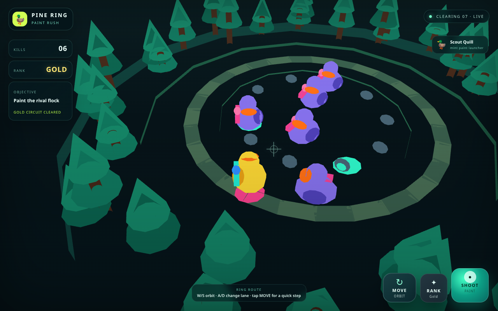
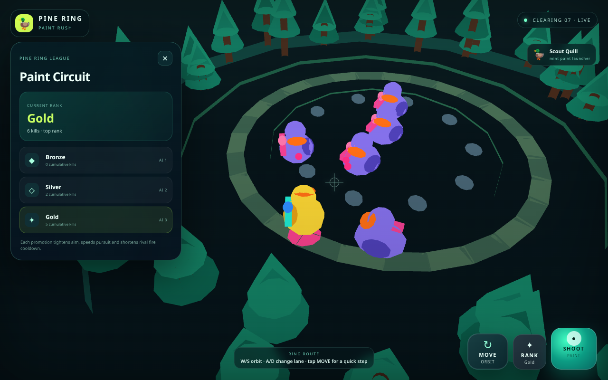
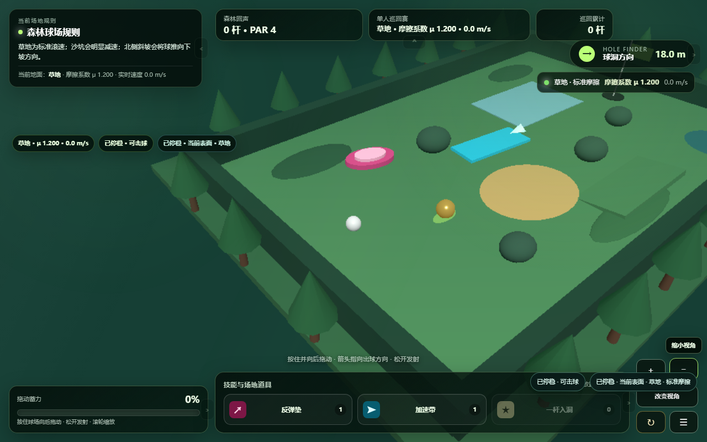
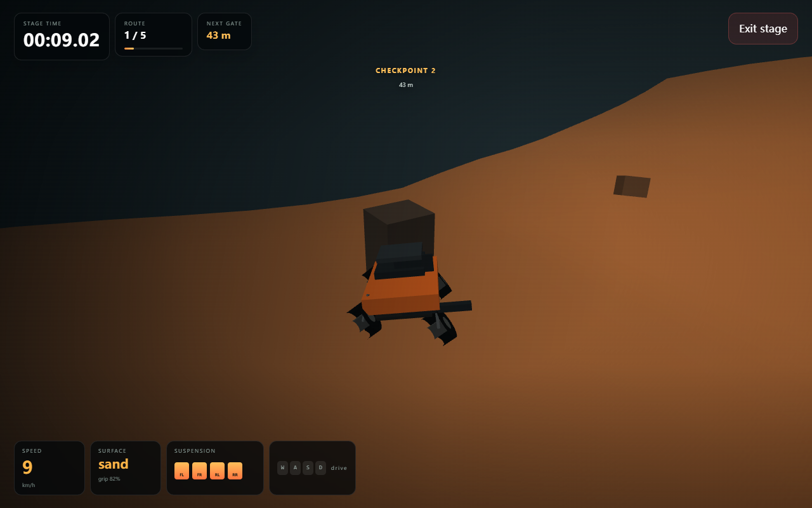

# 网页游戏自动化测试与评测 · 实习作品节选

**本仓库是本人大二实习期间独立完成的工作作品节选，用于记录和展示当时的网页游戏测试与评测实践，不作为最终成品。**

项目包含评测脚本、评分规则、被测游戏样例及运行记录，展示从游戏需求拆解、自动化验证到评测结果汇总的工作过程。

## 目录

- [项目背景](#项目背景) · [评测流程](#评测流程) · [具体检查什么](#具体检查什么)
- [运行截图](#运行截图) · [项目内容](#项目内容) · [环境准备](#环境准备)
- [运行示例](#运行示例) · [结果说明](#结果说明)

## 项目背景

网页游戏既有可明确判断的规则和状态，也有需要观察画面才能评价的内容。例如，点击射击按钮后是否真正产生攻击，可以结合页面输入和游戏状态检查；角色主题、场景表现和界面可读性，则需要查看实际截图。

这批工作围绕上述两类问题组织测试：使用 Python 和 Playwright 驱动浏览器，通过页面元素与游戏暴露的状态接口验证功能，再由视觉语言模型（VLM）辅助判断部分画面要求。

测试代码、被测样例与任务材料相互对应，可以结合需求查看检查逻辑，再对照结果了解各条目的判定依据。

## 评测流程

```text
游戏需求与评分规则
        ↓
构建或加载被测游戏 → 浏览器基础检查
        ↓
页面操作与状态验证 + 截图与视觉评分
        ↓
逐条记录检查结果 → 汇总功能与视觉结果
```

| 环节 | 在项目中的作用 |
| --- | --- |
| 规则整理 | 将需求拆成评分条目，注明使用 DOM、状态或视觉方式判定 |
| 基础检查 | 确认页面能否加载、是否出现阻断运行的错误、是否存在游戏内容 |
| 功能验证 | 模拟点击、移动、射击等操作，观察页面与游戏状态的实际变化 |
| 视觉判断 | 对实际截图进行评价，检查主题、场景与界面表现 |
| 结果汇总 | 记录各条目的得分和依据，分别汇总功能与视觉结果 |

部分脚本还会观察渲染调用、运行时事件或状态变化，交叉检查样例是否真实执行了相应行为。各任务实现不同，应结合具体脚本理解。

## 具体检查什么

以[鸭子射击的测试脚本](games/duck-shooting/web_ut.py)为例：

- **交互是否有效**：移动和射击按钮是否可见、可操作，操作后是否改变位置或产生攻击。
- **游戏规则是否成立**：敌方 Bot 是否参与战斗、击杀是否重复结算、段位是否按规定门槛晋升。
- **状态是否一致**：晋级后的当前段位、界面显示和 Bot 难度是否同步变化。
- **画面是否符合需求**：鸭子与彩弹主题、森林场景及界面可读性是否在截图中体现。

例如，“存在射击按钮”和“点击后真正产生射击”是两个不同的检查点；“页面显示晋级”也需要结合击杀进度与实际段位状态判断。这些检查用于验证操作、规则和状态之间的对应关系。

`repo_files/` 中的 `good`、`bad`、`cheat` 等命名用于区分预设的正常、缺陷和模拟通过检查的样例，便于观察评测脚本的区分能力。目录标签本身不构成当前版本的通过结论。

## 运行截图

以下为评测过程中留存的被测游戏画面，展示场景、操作界面和状态面板，属于实习期间的历史运行截图。

| 鸭子射击 · 游戏场景 | 鸭子射击 · 段位面板 |
| --- | --- |
| [](games/duck-shooting/ut_images/good_1_r24_1.png) | [](games/duck-shooting/ut_images/good_1_r26_3.png) |

| 3D 高尔夫 · 球场与击球界面 | 3D 赛车 · 赛道与车辆状态 |
| --- | --- |
| [](games/golf/ut_images/good_1_r34_1.png) | [](games/racing/ut_images/good_1_r34_1_race.png) |

点击图片可查看原图。画面用于辅助理解被测对象，具体功能是否满足要求需结合测试脚本和逐条评测结果判断。

## 项目内容

覆盖 9 类游戏：3D 多人炸金花、3D 高尔夫、3D 赛车、3D 天体、3D 骰子、3D 战舰、3D 蜘蛛侠、巴士游戏和鸭子射击。

| 游戏主题 | 项目目录 |
| --- | --- |
| 3D战舰 | [`games/battleship/`](games/battleship/) |
| 巴士游戏 | [`games/bus-driving/`](games/bus-driving/) |
| 3D天体 | [`games/celestial-simulation/`](games/celestial-simulation/) |
| 3D骰子 | [`games/dice/`](games/dice/) |
| 鸭子射击 | [`games/duck-shooting/`](games/duck-shooting/) |
| 3D高尔夫 | [`games/golf/`](games/golf/) |
| 3D多人炸金花 | [`games/multiplayer-poker/`](games/multiplayer-poker/) |
| 3D赛车 | [`games/racing/`](games/racing/) |
| 3D蜘蛛侠 | [`games/spider-man/`](games/spider-man/) |


各游戏的测试任务位于 `games/` 下，通常包含以下文件：

| 文件 / 目录 | 用途 |
| --- | --- |
| `prompt.md` | 游戏需求及原始任务描述 |
| `mapping.json` | 评分条目、判定方式和公开状态接口 |
| `web_ut.py` | 游戏专用检查逻辑 |
| `web_ut_harness.py` | 浏览器启动、构建、截图及评分基础设施 |
| `run.py` | 批量运行样例并汇总结果 |
| `repo_files/` | 游戏样例，包含正常、缺陷、作弊或模型生成版本 |
| `results.json` | 原有评测结果，属于历史记录，不代表当前环境复测结果 |

不同任务的接口和运行参数存在差异，具体以各目录脚本为准。部分样例仅有 HTML 或预构建产物，因此保留了 `dist/` 以支持复现。

建议按 `mapping.json → web_ut.py → web_ut_harness.py → results.json` 的顺序阅读，对照规则、操作、执行过程与结果。不同目录中的脚本是各自保留的版本，并未统一成一个可直接替换使用的框架。

## 环境准备

需要 Python 3.10+；源码样例的构建还需要 Node.js 和 npm。不同前端样例的具体依赖见各自 `package.json`。

```powershell
python -m venv .venv
.\.venv\Scripts\Activate.ps1
python -m pip install -r requirements.txt
python -m playwright install chromium
```

### 视觉模型配置

仓库已移除硬编码 API 密钥。运行视觉评分时，通过环境变量配置自己的密钥与可访问的模型：

```powershell
$env:ARK_API_KEY = "填写自己的密钥"
$env:ARK_VLM_MODEL = "填写自己的模型或端点 ID"
```

不要把真实密钥写回源码或提交到 Git。脚本直接读取进程环境变量，不会自动加载 `.env`。部分评测器支持 `SKIP_VLM=1`，是否支持请查看对应脚本；跳过视觉项不能视为完整评测通过。

## 运行示例

在仓库根目录激活 Python 环境后，进入鸭子射击任务目录：

```powershell
Set-Location "games/duck-shooting"
python web_ut.py --target ./repo_files/good_1 --build
```

`--build` 会安装并构建目标前端。也可针对现成 HTML 或构建目录运行：

```powershell
python web_ut.py --target ./repo_files/good_1/dist
```

批量入口通常为 `python run.py`，可能更新本地 `results.json` 并调用付费视觉模型，请先阅读对应任务的参数与配置。

## 结果说明

`results.json` 保存实习期间的评测记录，不能作为当前环境的重新验收结果。功能得分和视觉得分分别记录，阅读时应结合逐条检查依据。

部分脚本用 `-100` 标记视觉调用失败或未完成，该状态与实际判为不通过不同，具体以对应脚本为准。视觉判断也会受到截图时机、模型和提示词的影响。

各任务的接口、运行参数和依赖有所不同，复现时需要结合对应脚本配置环境。浏览器、前端依赖、模型权限与网络条件都可能影响运行结果。
